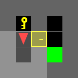
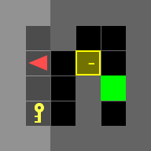
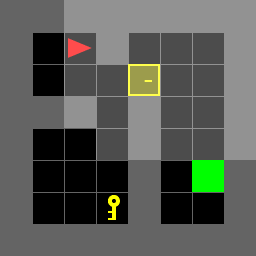
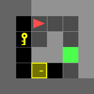
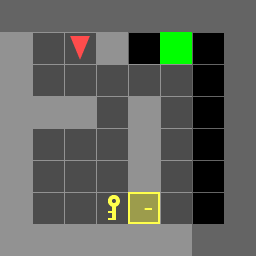
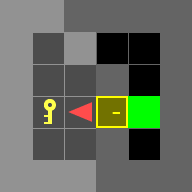
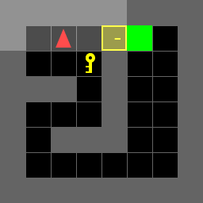
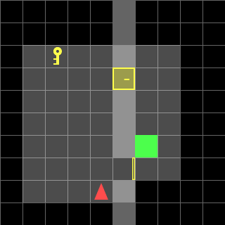
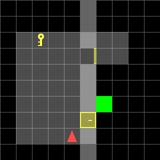
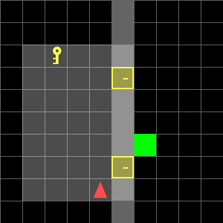

# ECE 276B Project 1: Dynamic Programming for Door & Key

A robot in a MiniGrid world must reach the goal. A locked door may block the way, and opening it needs
the key. Every action (move forward, turn left, turn right, pick up key, unlock door) costs 1. The
problem is set up as a deterministic Markov Decision Process and solved with backward dynamic
programming (value iteration until the values stop changing). It returns the cheapest action sequence
from the start.

- **Part A:** one optimal policy per map, for the 7 known maps.
- **Part B:** **one** policy, computed once, that works on all 36 random 10×10 maps.

Only `doorkey.py` (my code) and the result GIFs are in this repository. The course starter code and
map files are not included.

## Approach

The state is `(x, y, d, k, opens, key_i, goal_i)`:

| Part | Meaning |
|---|---|
| `x, y, d` | position and facing direction |
| `k` | holding the key? |
| `opens` | one open/closed flag per door |
| `key_i`, `goal_i` | which of the possible key and goal positions is the real one |

**One model covers both parts.** On a Part A map each list has one entry, so `key_i = goal_i = 0`. In
Part B the key, the goal and the door status differ between maps, so they become part of the state. A
single solve then covers every map, and each map only supplies its own starting state.

| Function | Role |
|---|---|
| `read_map` | walls, grid size, and the lists of doors, key positions and goal positions |
| `all_states` | the state space X (non-wall squares × every combination of the other parts) |
| `motion_model` | f(x, u): MiniGrid's rules for MF, TL, TR, PK and UD |
| `terminal_cost` | q(x): 0 on the goal, ∞ elsewhere |
| `solve` | Bellman recursion V(x) = min_u [ℓ(u) + V(f(x, u))] until V stops changing; returns V and the policy |
| `extract_sequence` | follows the policy from x₀ to the goal |

**Checks:**
- **Motion model:** compared with the MiniGrid simulator under random actions on all 43 maps, 0 mismatches.
- **Plans:** every plan was replayed in the simulator. It reaches the goal, and its length equals V(x₀).

## Part A: known maps

| Map | Size | States | Cost | Optimal actions |
|---|---|---|---|---|
| `doorkey-5x5-normal` | 5×5 | 112 | 9 | TL TL PK TR UD MF MF TR MF |
| `doorkey-6x6-direct` | 6×6 | 208 | 5 | MF MF TR MF MF |
| `doorkey-6x6-normal` | 6×6 | 208 | 13 | TL MF PK TL MF TL MF TR UD MF MF TR MF |
| `doorkey-6x6-shortcut` | 6×6 | 208 | 6 | PK TL TL UD MF MF |
| `doorkey-8x8-direct` | 8×8 | 480 | 7 | MF TL MF MF MF TL MF |
| `doorkey-8x8-normal` | 8×8 | 464 | 23 | TR MF TL MF TR MF MF MF PK TL TL MF MF MF TR UD MF MF MF TR MF MF MF |
| `doorkey-8x8-shortcut` | 8×8 | 448 | 8 | TR MF TR PK TL UD MF MF |

On the *direct* maps the plan never picks up the key. Nothing in the code says "skip the key". The
detour simply costs more, so the minimisation never chooses it.

| normal 5×5 | normal 6×6 | normal 8×8 |
|---|---|---|
|  |  |  |
| **direct 6×6** | **direct 8×8** | **shortcut 6×6** |
|  |  |  |
| **shortcut 8×8** | | |
|  | | |

## Part B: one policy for 36 random maps

All 36 maps share a 10×10 layout:
- a wall at column 5, with doors at (5,3) (top) and (5,7) (bottom);
- the key at (2,2), (2,3) or (1,6);
- the goal at (6,1), (7,3) or (6,6);
- the robot starting at (4,8), facing up.

One `solve` over 26,496 states (about 1.3 s) gives the policy for all of them.

Cost of the optimal plan for each map (map number in brackets):

| Key | Goal | both doors open | only top open | only bottom open | both locked |
|---|---|---|---|---|---|
| (2,2) | (6,1) | 11 (1) | 11 (2) | 11 (3) | 19 (4) |
| (2,2) | (7,3) | 9 (5) | 9 (6) | 10 (7) | 17 (8) |
| (2,2) | (6,6) | 6 (9) | 12 (10) | 6 (11) | 20 (12) |
| (2,3) | (6,1) | 11 (13) | 11 (14) | 11 (15) | 17 (16) |
| (2,3) | (7,3) | 9 (17) | 9 (18) | 10 (19) | 15 (20) |
| (2,3) | (6,6) | 6 (21) | 12 (22) | 6 (23) | 18 (24) |
| (1,6) | (6,1) | 11 (25) | 11 (26) | 11 (27) | 19 (28) |
| (1,6) | (7,3) | 9 (29) | 9 (30) | 10 (31) | 17 (32) |
| (1,6) | (6,6) | 6 (33) | 12 (34) | 6 (35) | 16 (36) |

How to read it:
- **When at least one door is open, the key never matters.** The plan walks through an open door and
  never picks up the key, so the first three columns are the same for every key position.
- **When both doors are locked, the key's position decides the cost,** because the robot has to fetch
  the key first.
- **An open door far away can beat unlocking a near one.** For goal (6,6) with only the top door open,
  the robot takes the 12-action detour through the top door. Fetching the key and unlocking the bottom
  door would cost more.

| Map 11: bottom door open (6) | Map 10: only top door open (12) | Map 12: both locked (20) |
|---|---|---|
|  |  |  |

All 36 GIFs are in [`gif/partB/`](gif/partB/).

## Running

Requires Python 3.8–3.12, `gymnasium==0.28.1` and `minigrid`. Put `doorkey.py` into the course starter
code folder, then run:

```bash
python doorkey.py        # runs partA() and partB(); writes GIFs to gif/partA/ and gif/partB/
```
